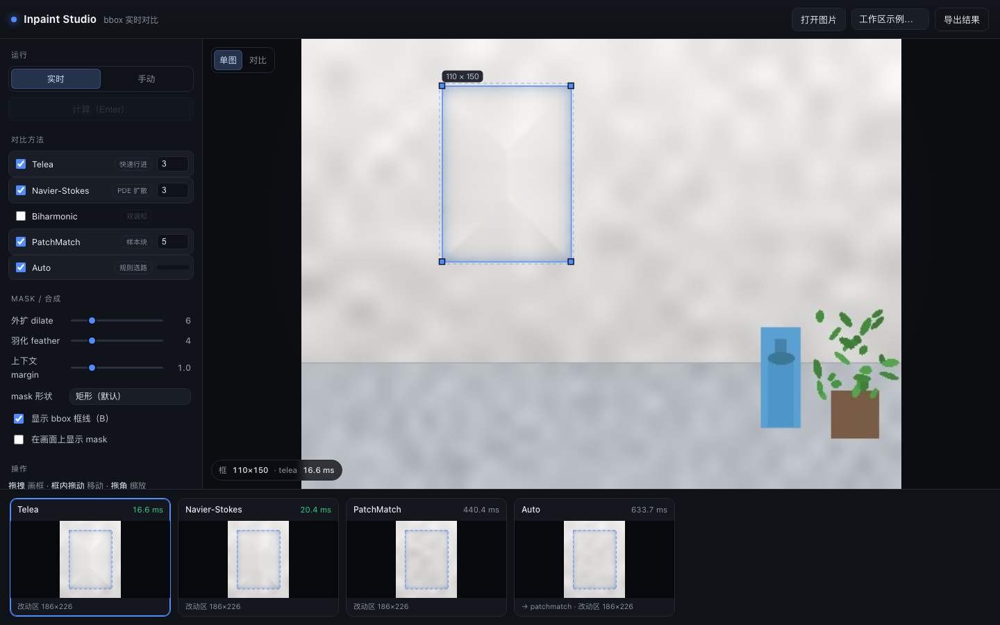
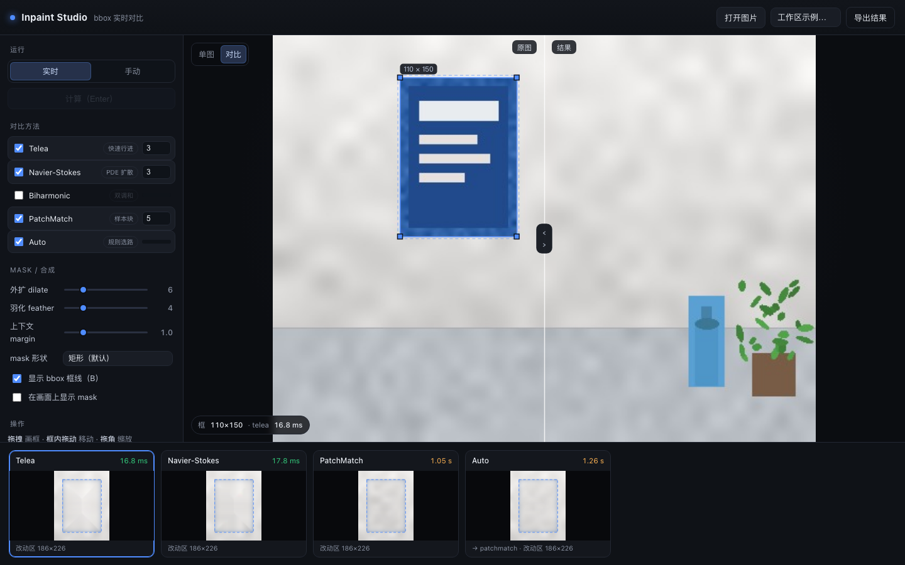
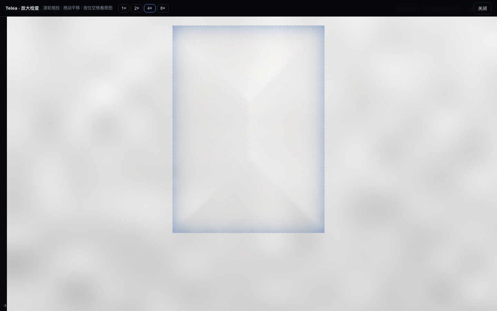

# bbox_inpainting

给一张图和框，用**规则方法**（不做扩散模型）把框里的东西抹掉，并且能实时对比几种算法的效果。

- 纯本地运行：`numpy + opencv`，可选 `PyPatchMatch / scikit-image`
- 一个命令行工具，一个网页版（拖框 → 几种方法并排出结果）
- 每个方法都返回**只被改动的小块**和耗时，方便逐块对比/合成



## 安装

```bash
python3 -m venv --system-site-packages .venv
.venv/bin/pip install -r requirements.txt

# 可选后端（装上界面里就多两列）
.venv/bin/pip install PyPatchMatch scikit-image
```

只用 `opencv` 也能跑，`Telea / NS / Auto` 一定可用；另外两个后端未安装时会被自动跳过。

## 网页版

```bash
./run_web.sh                      # http://127.0.0.1:8788
./run_web.sh --port 9000
./run_web.sh --samples ~/Pictures  # 换掉"工作区示例"目录（默认 examples/）
```

用法：打开图片（按钮 / 拖入 / `⌘V` 粘贴 / 下拉示例）→ 在图上拖出一个框 → 底部卡片并排显示各方法结果。

| 功能 | 说明 |
|---|---|
| 实时 / 手动 | 实时=改框即算；手动=改完参数点「计算（Enter）」 |
| 单图 / 对比 | 对比=左原图右结果，分割线可拖 |
| 显示 bbox 框线 `B` | 关掉后画面上只剩像素，便于判断接缝 |
| 放大检查（双击卡片） | 滚轮缩放、拖拽平移、`1×/2×/4×/8×`、按住空格看原图 |
| 导出结果 | 按当前方法在原始分辨率合成 PNG |

参数：`dilate`（mask 外扩，防留边）、`feather`（羽化，防接缝）、`margin`（参与计算的上下文窗口）、`mask 形状`（矩形 / GrabCut）。经验值 dilate 6–12、feather 3–5、margin 1.0。

URL 参数（便于分享某个 case）：

```
http://127.0.0.1:8788/?sample=demo_wall.png&box=120,40,110,150&compare=1
```

| 参数 | 说明 |
|---|---|
| `sample=<文件名>` | 打开 `--samples` 目录下的图 |
| `box=x,y,w,h` | 预设框（图像像素坐标） |
| `inspect=1` / `inspect=4` | 出结果后打开放大检查（可直接指定倍率） |
| `live=0` | 手动模式 |
| `compare=1` | 对比模式 |
| `hidebox=1` | 隐藏 bbox 框线 |





## 命令行

```bash
python -m bbox_inpaint.cli in.jpg 800,400,240,180 out.png
python -m bbox_inpaint.cli in.jpg 800,400,240,180 out.png --method patchmatch --dilate 8 --feather 5
python -m bbox_inpaint.cli --list          # 看哪些后端可用
```

`bbox` 格式是 `x,y,w,h`（左上角 + 宽高，单位像素）。

在代码里用：

```python
import cv2
from bbox_inpaint import inpaint_region

img = cv2.imread("in.jpg")
r = inpaint_region(img, (800, 400, 240, 180), method="auto", dilate=8, feather=4, margin=1.0)
print(r["name"], r["ms"], r["note"])   # 用了哪个后端、耗时、说明
x0, y0, x1, y1 = r["rect"]             # 改动区在原图中的位置
img[y0:y1, x0:x1] = r["image"]         # 只有这一块被改过
```

## 方法

| 后端 | 依赖 | 速度 | 适用 |
|---|---|---|---|
| `telea` | opencv | 最快（小框 2 ms） | 平坦背景，大洞会糊 |
| `ns` | opencv | 最快 | 平滑渐变背景更自然 |
| `biharmonic` | scikit-image | ~0.4 s | 大块渐变；会"渗色" |
| `patchmatch` | PyPatchMatch | 0.3–2 s | 有纹理的目标，纹理延续最好 |
| `auto` | — | 取决于选到谁 | 按洞占比 + 边缘梯度能量挑后端 |

实测（本机 CPU，合成洞）：

| 场景 | Telea | NS | Biharmonic | PatchMatch |
|---|---|---|---|---|
| 平坦墙 96×64 | 38.8 dB | 43.3 dB | — | — |
| 平坦墙 256×192 | 17.0 dB | — | 25.5 dB | 26.9 dB |
| 结构化 128×96 | 14.5 dB | — | 18.4 dB | — |

结论：**小洞 + 平坦背景，Telea/NS 就够**；洞稍大或有纹理，PatchMatch 值得多花那几百毫秒；
所有规则方法在大洞上都会留下可见痕迹（糊、条带、前沿碰撞接缝），这时候才需要考虑 LaMa / MI-GAN 这类轻量模型。

## 工程细节（比换算法更重要）

1. **bbox 外扩 6–12 px**：不扩会留下一圈原物体的边
2. **羽化 3–5 px**：硬贴回去会看到接缝
3. **窗口取局部，不要整图缩放**：把 bbox 周围一小块裁出来算，质量与速度都更好
4. **PatchMatch 的窗口要控大小**：成本随窗口涨，代码里按后端限了窗口像素上限

## 结构

```
bbox_inpainting/
├── bbox_inpaint/
│   ├── core.py        # 后端、mask 构造、窗口裁剪、羽化合成、选路
│   └── cli.py         # 命令行入口
├── web/
│   ├── server.py      # 标准库 HTTP 服务（无框架）
│   └── static/        # 原生 JS 画布界面
├── examples/          # 示例图 + 生成脚本
├── docs/              # 截图
├── tests/             # smoke test
└── run_web.sh
```

## API

| 路由 | 说明 |
|---|---|
| `GET /api/methods` | 各后端是否可用 |
| `GET /api/samples` | 列出 `--samples` 目录里的图 |
| `POST /api/upload?name=a.jpg` | body 为图片二进制 → `{id,w,h}` |
| `POST /api/open` | `{"path":"demo_wall.png"}`，限定在 samples 目录内 |
| `GET /api/image?id=` | 取回会话里的原图（JPEG） |
| `POST /api/inpaint` | `{id,bbox,method,dilate,feather,margin,mask_mode,params}` → `{method,ms,rect,png,mask_png}` |
| `POST /api/export` | 同参数，返回整图 PNG |

`rect` 是改动区在原图中的位置；`png` 只覆盖这一块（mask 外像素与原图逐位相同），所以前端只需贴一小块。

## 测试

```bash
python -m unittest discover -s tests -v
```

## 已知限制

- 大洞（占图 10% 以上）规则方法都会明显翻车，本工具的价值是让你**快速看到翻车方式**，而不是许愿
- `auto` 的选路规则很朴素，速度优先时可手动指定
- 只支持单张图单个框的交互；批量场景直接用 `inpaint_region()` 写脚本

## License

MIT — 见 [LICENSE](LICENSE)。
